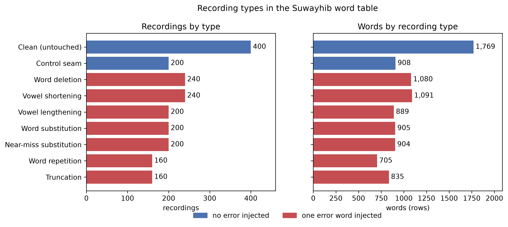
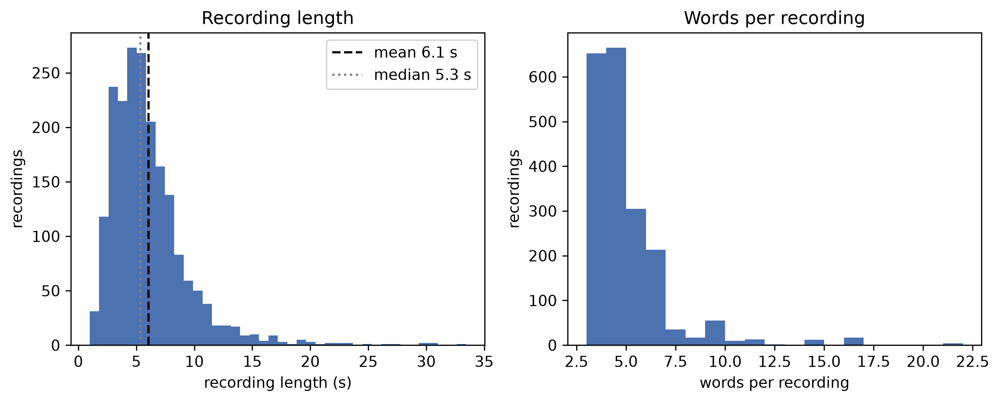
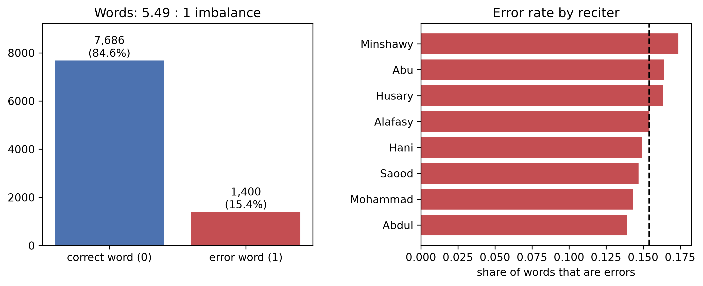

# Suwayhib: Data Preprocessing for Word-Level Recitation Error Detection

## Problem Statement

Suwayhib is an offline Qur'an recitation companion for young learners in under-resourced schools in Northern Nigeria. Kaduna is our case study. One teacher there may look after 50 to 100 students. A learner recites a known verse into the device. The device checks each word and says whether the word was recited correctly. It then replays the learner's mistaken words next to a reference reciter. Everything runs on the device, with no internet. This fits SDG 4 (Quality Education) and SDG 10 (Reduced Inequalities).

This repository covers one decision inside that device. Given the alignment features of one recited word, is the word mispronounced? A missed error lets a bad habit form. A false alarm discourages the learner. We audit the data for this decision. We then build a preprocessing pipeline that learns every statistic from training data only.

## Dataset Overview

### How the data was made

The reference audio comes from the [EveryAyah](https://everyayah.com/) corpus. It has 8 professional reciters and one MP3 per verse. The word timings come from [cpfair/quran-align](https://github.com/cpfair/quran-align), and the verse text comes from [Tanzil](https://tanzil.net/).

The Suwayhib test-set builder took 2,000 verse recordings. It put one controlled error into 1,400 of them, at a known word. We call that word an error word. Every other word is a correct word. The builder then aligned each recording to the reference recitation. It used dynamic time warping (DTW) over mel-frequency cepstral coefficients (MFCCs). The alignment gives one row of features per word, such as alignment cost, duration ratio, and relative width.

Why do we align with quran-align, and why does it work? We give four reasons.

**The text is known.** A learner recites a fixed verse. So the device does not need to recognize what was said. It only needs to decide whether each word differs from a known reference. That is a smaller problem than speech recognition. It is also cheap enough to run offline on a low-end device.

**quran-align gives the word boundaries.** It lists the start and end time of every word in every EveryAyah recording. Without it, we would have to build and test our own forced aligner. With it, the builder can place an error at an exact word. The scorer can also read the DTW path against fixed word boundaries in the reference. We did not rerun the builder. So we take the link between the timings and the error placement from the project description.

**Errors change the warping path.** DTW stretches the learner's MFCCs onto the reference. The part of the path inside each reference word gives that word's features. The `collapsed` feature marks a word that the path squeezed to almost nothing. Deletion and truncation make a word shorter. Repetition and lengthening make it longer. This is why `dur_ratio` carries signal that a linear correlation misses (Phase 2 report, Section VI).

**There is a limit.** A different reciter, or a faster one, also adds warping cost without making a mistake. For this reason we split by reciter and not by row. The errors are also synthetic. So our results come from simulated mistakes, not from real learners.

### Recording types

| Recording type | Count | Is an error? |
|---|---|---|
| Clean (untouched) | 400 | No |
| Control seam (spliced, but no real change) | 200 | No |
| Word deletion | 240 | Yes |
| Vowel shortening (madd) | 240 | Yes |
| Vowel lengthening (madd) | 200 | Yes |
| Word substitution | 200 | Yes |
| Near-miss substitution | 200 | Yes |
| Word repetition | 160 | Yes |
| Truncation | 160 | Yes |



*Figure A. Every row of the table above, in recordings (left) and in words (right). Blue bars are types with no error. Red bars are types with one error word per recording.*

### What the dataset contains

| Item | Value |
|---|---|
| Source | Suwayhib labeled synthetic-error test set, built from [EveryAyah](https://everyayah.com/) audio, [cpfair/quran-align](https://github.com/cpfair/quran-align) word timings and [Tanzil](https://tanzil.net/) verse text |
| Unit of observation | One word in one recorded verse |
| Sample size (N) | 9,086 words, from 2,000 recordings and 8 reciters |
| Feature count (P) | 22 columns before preprocessing (word-level alignment features and recording metadata) |
| Target (Y) | `is_error_word`: 1 if the word has an injected error, else 0 |
| Positive rate | 15.4% (1,400 error words) |

A recording is one verse (a surah and an ayah) recited by one reciter. A word is one row of the table. A recording has 3 to 21 words. Each error recording has exactly one error word. Its other words are labeled correct. Word deletion is an example. It has 240 recordings and 1,080 words, and 240 of those words are error words (Figure A, right). Each row holds the DTW features of the word. It also holds the reciter, the verse, and the recording-level metadata (durations and number of words).

### Recording length statistics

The table has one value per recording (n = 2,000). Recording length is the length after any error was added. Reference length is the length of the original recording before the edit.

| | Mean | Std | Min | 25% | Median | 75% | Max |
|---|---|---|---|---|---|---|---|
| Recording length (s) | 6.05 | 3.44 | 0.97 | 3.78 | 5.34 | 7.29 | 33.43 |
| Reference length (s) | 6.38 | 3.39 | 1.83 | 4.23 | 5.63 | 7.50 | 32.31 |
| Words per recording | 4.54 | 2.13 | 3 | 3 | 4 | 5 | 21 |



*Figure B. Both distributions have a long right tail. Most recordings are short verses of 3 to 5 words. A few verses are long.*

Truncation makes a recording the shortest (mean 3.86 s). Repetition and lengthening make it longer (about 7.3 s). The full statistics are in `data/processed/dataset_overview.txt`.

### Is the dataset balanced?

No. Of 9,086 words, 7,686 are correct and 1,400 are error words. That is a ratio of 5.49 : 1 (15.4% positive). At the recording level, 600 recordings (30%) have no error and 1,400 (70%) have one. The word-level imbalance matters more for the model. An error recording is mostly correct words.

The imbalance looks similar for every reciter. The error rate runs from 13.9% to 17.4% (Figure C). So the imbalance belongs to the task, not to one voice. On the training split the ratio is 5.70 : 1 (14.9% positive). On the two test reciters the positive rate is 16.8%.

We do not resample. The classifiers use class weights, and we compare them by PR-AUC and Macro F1. Accuracy cannot guide us here. A model that never flags a word scores 84.6%.



*Figure C. Left: words by class. Right: share of words that are error words, by reciter. The dashed line is the overall rate.*

### Missing data

**Missing values.** One of the 22 columns has missing values. `stretch_rate` is missing for 7,106 of 9,086 words (78.2%). The other 21 columns are complete. The value exists only for the two madd error types (vowel shortening and lengthening). It is a setting of the error generator. So a missing `stretch_rate` tells the model which recording type it is looking at. That makes the missingness Missing Not At Random (MNAR), and it leaks the label. We drop the column and do not impute it. Figure 1.1 shows the pattern.

**Missing files.** The raw audio (`audio/*.wav`) and the generator manifest `manifest_full.csv` are not in this repository. The audio is gitignored. The pipeline does not need either file, because it starts from the derived tables in `data/raw/`. The result is that nobody can rebuild the dataset from this repository alone. The `detect` block in `scores_full.jsonl` is a recording-level score, not a word-level feature. We do not use it.

### Raw files

The folder `data/raw/` holds three files:

- `labels.jsonl`: one row per recording (reciter, surah, ayah, word count, durations, error type, and the index of the affected word).
- `scores_full.jsonl`: one row per recording, with a list of per-word alignment features.
- `testset_meta.json`: generation settings (seed, sample rate, counts, held-out reciters).

We include no audio and process none. We use only these derived tables.

**Change from the project proposal.** The proposal named the IqraEval (IQRA 2026) corpus for evaluation. We use the Suwayhib test set instead. It is already on disk, it is labeled per word, and it matches the scorer that the device runs. IqraEval stays as future work for testing on real learners.

**Known limit.** The errors are synthetic splices into the audio of professional reciters. The data has no mistakes from real learners. It has no Hausa-accented or Fulfulde-accented speech.

## Task Type

Binary classification. A word is mispronounced, or it is not.

## Why Phase 2 Is Built This Way

Each choice below comes from a finding in the Phase 1 audit or from the design review. The Phase 2 report has the full decision log.

**We split by reciter, before we fit anything.** Words from one recording share a voice, a verse, and a speaking speed. A random row split would put the same voice on both sides. That would make every score look better than it is. Six reciters train the model. Two reciters (Husary and Minshawy) are held out for one final test. Cross-validation on the training side holds out one reciter at a time. This setup asks the question the device faces: how does the model do on a voice it has never heard?

**Every statistic comes from training data only.** The imputer, the IQR fences, and the scaler sit inside a scikit-learn `Pipeline`. Each cross-validation fold refits them on its own training reciters. We first ran the Phase 1 audit on all rows. So the test reciters could shape the drop decisions. We now repeat the audit on the training reciters only (`python src/audit.py --train-only`). No drop changed. One log choice moved. `dur_ratio` has skew 1.22 on all rows and 0.92 on the training reciters. That is just under our rule of skew above 1. We keep the log transform as a judgment call.

**We drop columns that describe the generator.** `error_type`, `tier`, and `stretch_rate` tell us how the builder made the error. They do not tell us how it sounds. The first word of a verse is never an error word. That rule is what `word_idx` picks up, and a real learner does not follow it. A model that used these columns would score well here and fail in a classroom.

**We use tree ensembles and keep a linear baseline.** `dur_ratio` is among the strongest features by mutual information (MI). Yet its correlation with the target is near zero (|r| = 0.08 on the training split). So its link to the target is not linear. Logistic regression stays as the baseline (CV PR-AUC 0.463). We compare histogram gradient boosting, LightGBM, random forest, and extra trees on the same folds.

**We add context from neighboring words.** Recitation goes in order. So the words next to a word can change how we should read its alignment. Neighbor features are the `dtw_cost` and `dur_ratio` of the previous word (lag) and the next word (lead) in the same recording. They give the biggest single gain. Gradient boosting goes from 0.705 to 0.757 CV PR-AUC. The first and last word reuse their own value for the missing neighbor. So the features do not show which word is first.

**We select by PR-AUC and Macro F1.** The imbalance is 5.49 : 1. Accuracy rewards a model that never flags a word. We pick the model by PR-AUC on out-of-fold predictions only. We also pick the decision threshold (0.60) out of fold. We score the test reciters once.

**`rec_len_ratio` needs care.** It is the recording length after the edit divided by the length before it. It equals exactly 1.000 for every untouched recording. So it partly records that an edit happened, and that is a property of the generator. Removing it lowers CV PR-AUC from 0.757 to 0.595. A real learner has no original recording to compare against. So the headline results are an upper bound. The Phase 2 report, Section VII, has the details.

## Repository Layout

```
data/raw/                      original tables, unaltered
data/processed/                cleaned, encoded and scaled feature table
phase1_strategy/               Phase1_Strategy_Report.pdf and the audit outputs
phase2_implementation/
  notebooks/pipeline_execution.ipynb
  Phase2_Final_Report.tex      IEEE two-column source of the report
  Phase2_Final_Report.pdf
pdfdocs/                       copies of both report PDFs
src/
  build_dataset.py             joins the raw files into the word table
  audit.py                     the Phase 1 audit (--train-only for the training reciters)
  dataset_overview.py          the figures and statistics in this README
  transformers.py              custom scikit-learn transformers
  pipeline_builder.py          ColumnTransformer and Pipeline definitions
figures/                       the 8 diagnostic figures (300 DPI) and 3 overview figures
```

## Environment Setup

```bash
python -m venv .venv
.venv\Scripts\activate          # Windows; use `source .venv/bin/activate` elsewhere
pip install -r requirements.txt
```

## Reproduction

```bash
jupyter nbconvert --to notebook --execute --inplace phase2_implementation/notebooks/pipeline_execution.ipynb
python src/dataset_overview.py
```

The notebook builds the word table from `data/raw/`. It writes the processed tables to `data/processed/` and saves the 8 figures to `figures/`. The second command redraws the three overview figures used in this README.

## Pipeline Summary

1. **Build** (`src/build_dataset.py`). Join `labels.jsonl` and `scores_full.jsonl` into a 9,086 × 23 word table.
2. **Split first, by reciter.** Six reciters train (6,763 rows, 74.4%). Two reciters test (Husary and Minshawy, 2,323 rows, 25.6%). No reciter or recording is on both sides.
3. **Preprocess** (`src/pipeline_builder.py`, fit on `X_train` only). We add `rec_len_ratio`. We drop 14 columns chosen in Phase 1: leakage, identifiers, near-zero variance, and collinear features. Then we impute with the median, apply `log1p` to four right-skewed features, winsorize at 3×IQR fences, and standardize. The 22 features become 9, and no rows are deleted. The final model adds four neighbor features, so it has 13 inputs.
4. **Validate** with leave-one-reciter-out cross-validation. Each fold refits the whole pipeline. We compare 20 candidates (five model families, each with and without neighbor features). The table lists the best setting for each family.

   | Model (CV, 6 training reciters) | PR-AUC | Macro F1 |
   |---|---|---|
   | Logistic regression | 0.463 | 0.666 |
   | Extra trees | 0.670 | 0.744 |
   | Random forest | 0.698 | 0.787 |
   | LightGBM | 0.707 | 0.774 |
   | Gradient boosting | 0.705 | 0.785 |
   | **Gradient boosting with neighbor features** | **0.757** | **0.812** |

5. **Test once** on the held-out reciters, at the out-of-fold threshold of 0.60. PR-AUC is 0.780. ROC-AUC is 0.924. Macro F1 is 0.829. The F1 of the error class is 0.712. Chance PR-AUC is 0.168.

## Deliverables

| Deliverable | Location |
|---|---|
| Phase 1 audit output | `phase1_strategy/audit_output.txt` (`python src/audit.py`) and `phase1_strategy/audit_output_train_only.txt` (`python src/audit.py --train-only`) |
| Phase 1 report | `phase1_strategy/Phase1_Strategy_Report.pdf`, copy in `pdfdocs/Phase1_Strategy_Report.pdf` |
| Notebook | `phase2_implementation/notebooks/pipeline_execution.ipynb` |
| Phase 2 report (IEEE two-column format) | `phase2_implementation/Phase2_Final_Report.pdf` (source `Phase2_Final_Report.tex`), copy in `pdfdocs/Phase2_Final_Report.pdf` |
| Figures | `figures/` (8 PNGs at 300 DPI, plus 3 overview figures) |

The folder `pdfdocs/` holds copies of the current report PDFs. Both open from one place.
